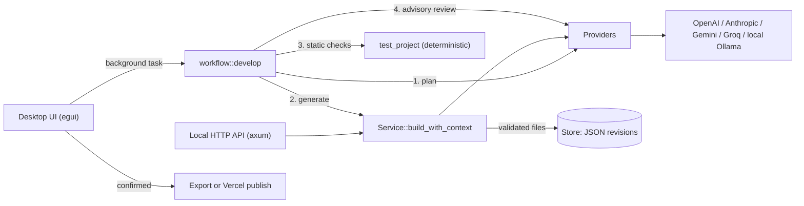

# Tesserun AI system design

This document describes how Tesserun uses language models, and reviews the design against common AI system design practices. It reflects the code in `rust/` as of version 0.3.0.

**Summary:** Tesserun meets the core practices for safety and control. It validates model output against a strict schema, never executes generated code, restricts network targets, and requires explicit human confirmation before anything is published. Its main gaps are in evaluation, observability, and resilience: there are no quality evaluations, no request logging or cost tracking, and no retries when a provider fails or returns malformed output.

## 1. Architecture

| Component | File | Role |
| --- | --- | --- |
| Provider adapter | `rust/providers/` | Builds one request per provider, enforces limits, decodes and checks completion status |
| Generation service | `rust/service.rs` | Prompts for a JSON file bundle, parses it, validates it, saves a revision |
| Workflow | `rust/workflow.rs` | Runs Planner → Developer → deterministic checks → Reviewer |
| Validation | `rust/domain.rs` | File allowlist, size and count limits, chat window limits |
| Storage | `rust/storage.rs` | Immutable revision files; loads the newest revision per project |
| Release | `rust/release.rs` | Opt-in, confirmed Vercel deployment |
| UI task runner | `rust/ui/tasks.rs` | One cancellable operation at a time; stale results are discarded |

## 2. Request pipeline

One build makes exactly three model requests, in sequence:

1. **Planner.** Asks for an implementation plan and acceptance criteria (up to 1,500 characters requested; up to 4,000 kept).
2. **Developer.** Asks for `{"files":[{"path","content"}]}` JSON. The plan is passed as context but is not saved; only the user's prompt is stored. The parser accepts bare JSON, fenced JSON, or JSON surrounded by prose.
3. **Deterministic checks.** No model call. Checks file rules, a non-empty `index.html`, external URLs, and markers such as `eval(` and `document.cookie`.
4. **Reviewer.** Sends bounded source excerpts (18,000 bytes per file) for advisory findings. If this call fails, the generated project is kept and the reviewer is marked "Needs attention".

Chat uses the same provider adapter. It sends the most recent messages that fit within 200 messages and 300,000 bytes.

## 3. Controls and limits

| Control | Value |
| --- | --- |
| Allowed output files | `index.html`, `styles.css`, `app.js`, `logic.mjs`, `README.md` |
| Output size | 4 MB total per project |
| Prompt length | 1–20,000 bytes |
| Max output tokens | 8,192 (OpenAI, Anthropic, Groq); provider default for Gemini and Ollama |
| Provider response size | 8 MB |
| Request timeout | 120 seconds (providers), 60 seconds (Vercel) |
| Redirects | Disabled |
| Ollama endpoint | Loopback only (`localhost`, `127.0.0.1`, `[::1]`) |
| Incomplete output | Rejected (for example, output that hit the token limit) |
| API access | Bearer token of at least 32 characters; requests with an `Origin` header are rejected; 512 KB body limit |
| Publishing | Requires `TESSERUN_ENABLE_VERCEL_DEPLOYMENTS=true`, a token, and a fresh confirmation for each release |

## 4. Design review

Status key: **Meets** = practice is implemented; **Partial** = partly implemented; **Gap** = not implemented.

| Area | Status | Assessment |
| --- | --- | --- |
| Clear task decomposition | Meets | Separate Planner, Developer, and Reviewer requests with defined inputs and outputs. |
| Structured output and validation | Meets | Strict schema, path allowlist, duplicate and size checks before saving. |
| Untrusted output handling | Meets | Generated code is never executed; it is only stored, checked lexically, exported, or published after confirmation. |
| Prompt injection resistance | Partial | The reviewer prompt treats source as untrusted, and output is schema-constrained. The user prompt is inserted directly into instructions without delimiters. |
| Human in the loop | Meets | Export and publishing each require explicit, single-use confirmation. Nothing deploys automatically. |
| Honest capability reporting | Meets | Reports state that runtime behavior is unverified; `runtime_verified` and `deployment_ready` are always false. |
| Network and credential safety | Meets | Keys stay in memory or environment variables and are never saved with projects. Ollama is loopback-only. Redirects are disabled. |
| Bounded resources | Meets | Limits on prompt, conversation, response, output, and request time. |
| Failure handling | Partial | Incomplete outputs are rejected, reviewer failure keeps the project, and crashed tasks report an error. There are no retries, backoff, or repair requests for invalid JSON. |
| Provider abstraction | Partial | One entry point for all providers, but provider logic is spread across string `match` blocks in two files. Adding a provider requires editing both. |
| Prompt management | Gap | Prompts are inline strings with no versioning, so saved projects don't record which prompt produced them. |
| Evaluation | Gap | Tests use fixed fixture responses. There is no benchmark set of briefs and no measurement of generation quality or reviewer accuracy. |
| Runtime verification | Gap | No sandbox runs generated apps or behavior tests. |
| Observability | Gap | No structured logs, latency, or token usage records. Provider error bodies are deliberately hidden, so failures show only an HTTP status. |
| Cost control | Gap | No token or cost estimate before a build, no usage totals, and no rate limits on the local API. |
| Reviewer independence | Partial | The reviewer is a separate request but uses the same provider and model as the developer, so it shares the developer's blind spots. |
| Data privacy | Partial | Prompts and source go to the selected provider (or stay local with Ollama). Saved projects are stored unencrypted on disk. |
| Reproducibility | Partial | Revisions are immutable and the original prompt is saved. The model ID, provider, and plan used for a build are not saved. |

## 5. Recommendations

In priority order:

1. **Record build metadata.** Save provider, model ID, prompt version, plan text, token usage, and duration with each revision. This enables debugging, reproducibility, and cost tracking at low effort.
2. **Add one repair attempt.** When the Developer's JSON fails to parse or validate, send the validation error back once and ask for corrected JSON.
3. **Retry transient failures.** Retry HTTP 429 and 5xx responses with backoff, honoring `Retry-After`.
4. **Use native structured output.** Request JSON mode or a response schema where the provider supports it (OpenAI, Gemini, Ollama `format`), instead of relying on prompt instructions alone.
5. **Delimit user input in prompts.** Wrap the brief in clearly marked tags and tell the model to treat it as a requirement, not as instructions that change the output format.
6. **Build an evaluation set.** Keep 10–20 reference briefs with acceptance checks, and run them against each prompt or model change.
7. **Let the reviewer use a different model.** An optional separate reviewer connection gives a more independent second opinion.
8. **Move prompts into versioned constants**, one module per role, so changes are reviewable and recorded with each build.
9. **Add a sandboxed preview** (for example, a locked-down WebView with network disabled) as the first step toward runtime verification.
10. **Show estimated cost** before a build, and add a rate limit to the local API.
