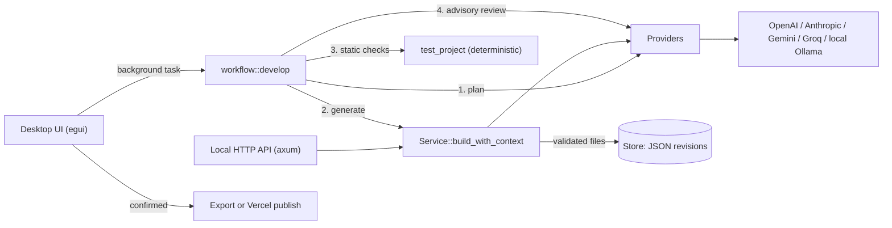

# Tesserun AI system design

This document describes how Tesserun uses language models, and reviews the design against common AI system design practices. It reflects the code in `rust/` as of version 0.3.0.

**Summary:** Tesserun meets the core practices for safety and control. It validates model output against a strict schema, never executes generated code, restricts network targets, and requires explicit human confirmation before anything is published. It also retries busy providers, asks once for a corrected reply when output is unusable, keeps prompts versioned, and saves build metadata with each project. The remaining gaps are quality evaluation, token and cost tracking, runtime verification, and an independent reviewer model.

## 1. Architecture

| Component | File | Role |
| --- | --- | --- |
| Provider adapter | `rust/providers/` | Builds one request per provider, enforces limits, decodes and checks completion status |
| Prompts | `rust/prompts.rs` | Versioned prompts for each role; user text is wrapped in delimiters |
| Generation service | `rust/service.rs` | Requests a JSON file bundle, repairs it once if unusable, validates it, saves a revision with build metadata |
| Workflow | `rust/workflow.rs` | Runs Planner → Developer → deterministic checks → Reviewer |
| Validation | `rust/domain.rs` | File allowlist, size and count limits, chat window limits, build metadata type |
| Storage | `rust/storage.rs` | Immutable revision files; loads the newest revision per project |
| Release | `rust/release.rs` | Opt-in, confirmed Vercel deployment |
| UI task runner | `rust/ui/tasks.rs` | One cancellable operation at a time; stale results are discarded |

## 2. Request pipeline

A build makes three model requests in sequence, plus at most one repair request:

1. **Planner.** Asks for an implementation plan and acceptance criteria (up to 1,500 characters requested; up to 4,000 kept).
2. **Developer.** Asks for `{"files":[{"path","content"}]}` JSON, using the provider's native JSON mode where available (OpenAI, Gemini, Ollama). The user's brief and the plan are wrapped in `<brief>` and `<plan>` tags that the text cannot close early. The parser accepts bare JSON, fenced JSON, or JSON surrounded by prose.
3. **Repair (only if needed).** If the reply can't be parsed or fails validation, Tesserun sends the reply and the reason back once and asks for a corrected project. If that also fails, nothing is saved.
4. **Save.** The project is saved with its original brief and build metadata: provider, model, prompt version, plan, timestamp, duration, and whether a repair was needed. Credentials are never saved.
5. **Deterministic checks.** No model call. Checks file rules, a non-empty `index.html`, external URLs, and markers such as `eval(` and `document.cookie`.
6. **Reviewer.** Sends bounded source excerpts (18,000 bytes per file) for advisory findings. If this call fails, the generated project is kept and the reviewer is marked "Needs attention".

Every model request is retried up to twice when the provider responds with HTTP 429 or a 5xx error, or the connection fails. Retries wait 0.5 s and then 1 s, or the provider's `Retry-After` value (capped at 10 s).

Chat uses the same provider adapter. It sends the most recent messages that fit within 200 messages and 300,000 bytes.

## 3. Controls and limits

| Control | Value |
| --- | --- |
| Allowed output files | `index.html`, `styles.css`, `app.js`, `logic.mjs`, `README.md` |
| Output size | 4 MB total per project |
| Prompt length | 1–20,000 bytes |
| Max output tokens | 8,192 (OpenAI, Anthropic, Groq); provider default for Gemini and Ollama |
| Provider response size | 8 MB |
| Request timeout | 120 seconds (providers), 60 seconds (Vercel) |
| Redirects | Disabled |
| Ollama endpoint | Loopback only (`localhost`, `127.0.0.1`, `[::1]`) |
| Incomplete output | Rejected (for example, output that hit the token limit) |
| Retries | Up to 2, for HTTP 429, 5xx, and connection failures |
| Repair requests | At most 1 per build |
| API access | Bearer token of at least 32 characters; requests with an `Origin` header are rejected; 512 KB body limit; at most 2 concurrent model requests (others get HTTP 429) |
| Publishing | Requires `TESSERUN_ENABLE_VERCEL_DEPLOYMENTS=true`, a token, and a fresh confirmation for each release |

## 4. Design review

Status key: **Meets** = practice is implemented; **Partial** = partly implemented; **Gap** = not implemented.

| Area | Status | Assessment |
| --- | --- | --- |
| Clear task decomposition | Meets | Separate Planner, Developer, and Reviewer requests with defined inputs and outputs. |
| Structured output and validation | Meets | Native JSON mode where available, a strict schema, path allowlist, and duplicate and size checks before saving. |
| Untrusted output handling | Meets | Generated code is never executed; it is only stored, checked lexically, exported, or published after confirmation. |
| Prompt injection resistance | Meets | User text is wrapped in delimiters it can't close, and the prompt states that the brief can't change the output rules. Output is schema-validated regardless. This reduces, but can't eliminate, injection risk. |
| Human in the loop | Meets | Export and publishing each require explicit, single-use confirmation. Nothing deploys automatically. |
| Honest capability reporting | Meets | Reports state that runtime behavior is unverified; `runtime_verified` and `deployment_ready` are always false. |
| Network and credential safety | Meets | Keys stay in memory or environment variables and are never saved with projects. Ollama is loopback-only. Redirects are disabled. |
| Bounded resources | Meets | Limits on prompt, conversation, response, output, request time, retries, and concurrent API requests. |
| Failure handling | Meets | Retries with backoff for busy or failing providers, one repair request for unusable output, rejection of incomplete output, and reviewer failure keeps the project. |
| Prompt management | Meets | Prompts live in `rust/prompts.rs` with a version that is saved with each build. |
| Reproducibility | Meets | Revisions are immutable, and each build records its brief, provider, model, prompt version, and plan. Model sampling is not deterministic, so outputs still vary. |
| Provider abstraction | Partial | One entry point for all providers, but provider logic is spread across string `match` blocks. Adding a provider requires editing several of them. |
| Observability | Partial | Build duration and repair status are saved. There are no structured logs or token usage records, and provider error bodies are deliberately hidden, so failures show only an HTTP status. |
| Cost control | Partial | The local API allows at most 2 concurrent model requests, and retries and repairs are capped. There is no token or cost estimate before a build and no usage totals. |
| Reviewer independence | Partial | The reviewer is a separate request but uses the same provider and model as the developer, so it shares the developer's blind spots. |
| Data privacy | Partial | Prompts and source go to the selected provider (or stay local with Ollama). Saved projects are stored unencrypted on disk. |
| Evaluation | Gap | Tests use fixed fixture responses. There is no benchmark set of briefs and no measurement of generation quality or reviewer accuracy. |
| Runtime verification | Gap | No sandbox runs generated apps or behavior tests. |

## 5. Recommendations

Done in version 0.3.0: build metadata, one repair request, retries with backoff, native JSON mode, delimited user input, versioned prompts, and an API concurrency limit.

Remaining, in priority order:

1. **Record token usage.** Read each provider's usage fields and save input and output tokens with the build metadata.
2. **Show estimated cost** before a build, using recorded token counts and per-model prices.
3. **Build an evaluation set.** Keep 10–20 reference briefs with acceptance checks, and run them against each prompt version or model change.
4. **Let the reviewer use a different model.** An optional separate reviewer connection gives a more independent second opinion.
5. **Add a sandboxed preview** (for example, a locked-down WebView with network disabled) as the first step toward runtime verification.
6. **Move provider logic behind one type per provider**, so adding a provider touches one file.
7. **Offer encrypted project storage** for users who keep sensitive briefs.
